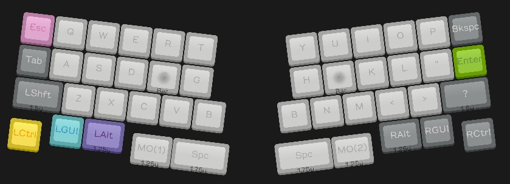
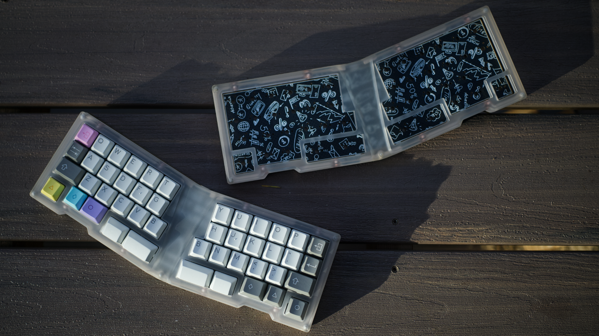
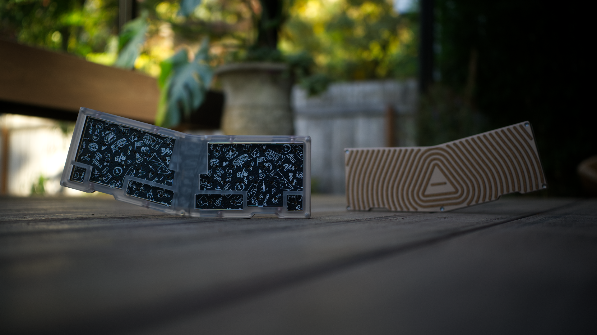
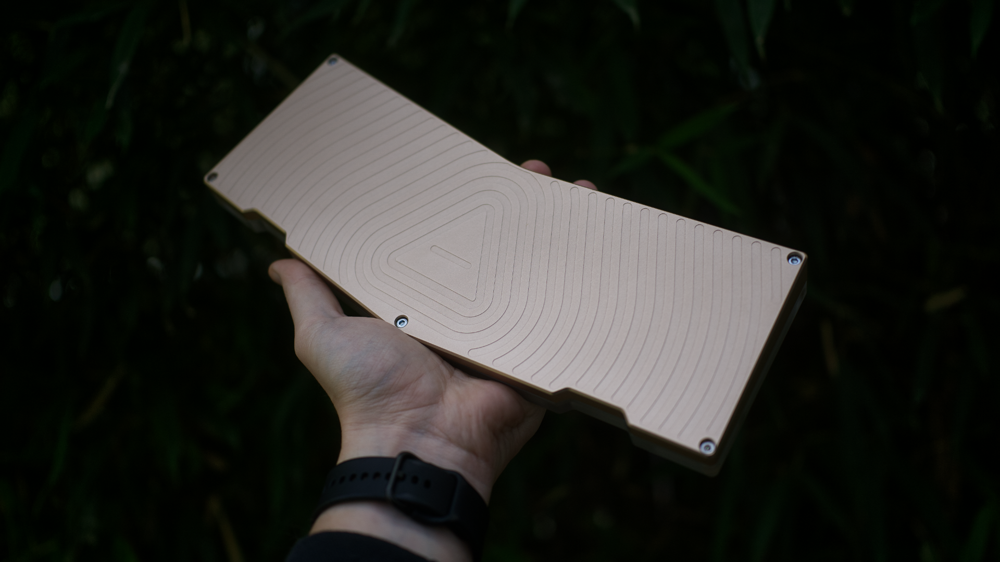
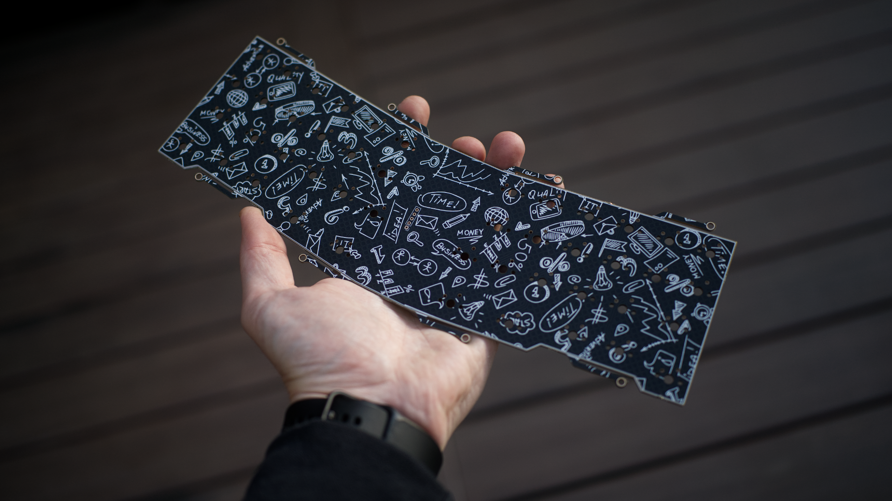
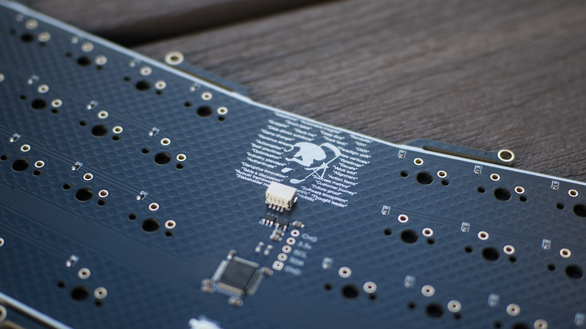
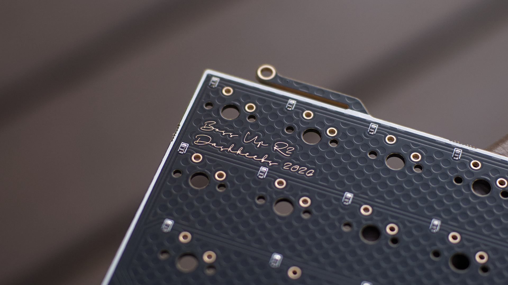

# **Boss Up**

Boss Up is an STM32 12u unibody split alphastag PCB with leaf spring tadpole mounting

The goal of this PCB is to exercise AVO and get, what I think is, the perfect board out into the world. Forced layout, forced solder, and crazy bouncy. The bottom case uses custom cut cork for the feet and goes into 0.2mm deep channels. The customer installed themselves, unless they opted to have me install it for them.

It was ciritcal to me that the board wasn't your typical experience. You don't just open it, solder switches, and drop in the PCB. You are involved in the build, you bring it all together, it takes time. It sounds a little silly, but the community has responded well and the goal was acheived! 

R1 was a private buy of 10 units with friends. The community responded very well so I did an R2.

I did a run of 26 units for R2. I gaveaway a *luxury* unit in the 40s Discord, then went live with the in stock drop 1 week later. The drop went insanley well and sold out out very fast:
- *Luxury*: Sold out in 30 seconds, limited to 5 units
- Grey: Sold out in 1 minute, limited to 10 units
- Brown: Sold out in 3 minutes, limited to 10 units

### **Of note:**
I *never* try to create artificial scarcity. **I never will.** I self fund and don't do group buys, so I am limited in the cash I can type up in keyboard buys. I will probably do an R3 as demand is still high and I want these boards in people's hands that really want them. Apologies to anyone who wasn't able to get a unit that tried due to them selling out so fast. I legit feel bad </3


The support from the community has been insane, especially for my first milled drop. I cannot stress how much it means to me. Thank you, truly, and from the bottom of my heart. I'm going to ride this momentum and keep making boards for y'all!

Big shoutout [Obabo](https://www.obabo.org/) for the case design! I gave him a paper with a very rough drawing and he cooked up the final case. I think it's beautiful, bold enough to have personality and be unique, but not too bold to be distracting. If you're ever looking for a case commission I HIGHLY suggest working with him!

<br>

### In this repo you will find:
```
- Layout options
- Images of PCB
- Firmware
- No STEP of PCB or edgecuts, I don't want to open source this any time soon as I'm planning more buys
```

VIAL firmware commissioned by [HaiZeus.](https://www.haikey.design/) Thank you again so much!

### KLC layout


[Link to KLC layout](https://keyboard-layout-creator.com/layout/cmld2yzt60012ph01oxg7fi4k)

### Images






